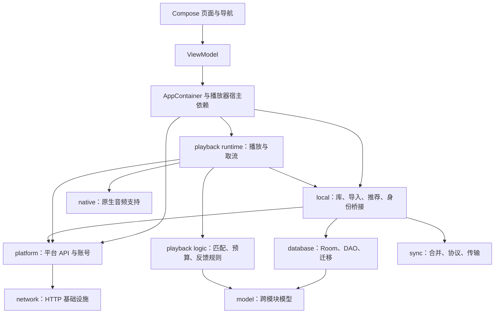
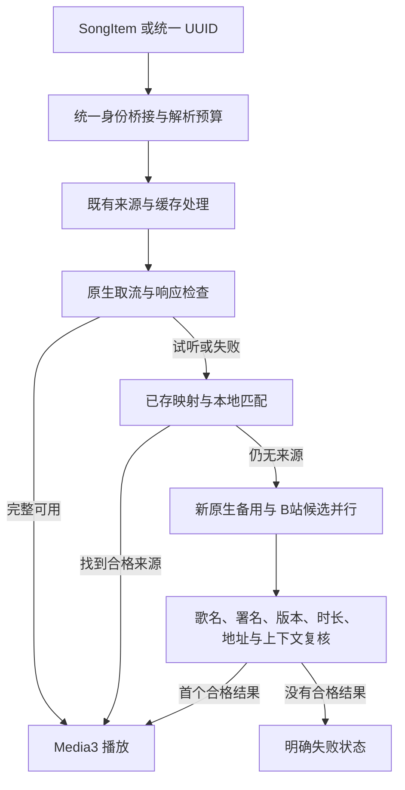

# UniMusic 开发交接报告

更新日期：2026-10-30，Asia/Shanghai。用途：直接提供给下一位开发者或下一个大模型，接续 `D:/unimusic`。

本报告依据当前源码、Git、Room 导出 schema、阶段记录、构建产物及已归档验证结果整理。报告不包含个人联系方式、口令、验证码、Cookie、设备序列号或临时签名播放地址。

## 1. 接手先看：项目现在到底到了哪里

UniMusic 是在 NeriPlayer 基础上继续开发的原生 Android 音乐客户端。当前已经形成较完整的应用工程：双标签导航、平台账号、本地媒体库、统一歌曲 UUID、网易云歌单导入、多来源搜索、播放与切源、本地推荐、下载、历史和同步相关入口都有实现。

**核心音源覆盖仍然是主要未完成问题。** 已经做了许多匹配、防误播、取消、缓存、状态和性能改进，但不能把这些改进等同于用户想听的歌曲已经能够播放。用户最近对实际效果不满意，重点反馈“哭泣少女乐队”的歌曲仍找不到原唱完整版；最新指定的下一项工作是接入 `UnblockNeteaseMusic/server` 并做好 Android 适配。

需要明确区分三件事：

1. 搜索得到歌曲元数据。
2. 接口返回了音频地址。
3. 用户从正常界面点击后，生产播放器确实播放了正确版本的完整音乐。

当前前两层的工程基础较多，第三层的覆盖和验收仍不足。下一个模型应优先把具体歌曲的真实播放闭环做通，再扩展覆盖，而不是只增加入口、状态说明或合成测试数量。

### 1.1 仓库与交接基线

| 项目 | 当前事实 |
| --- | --- |
| 本机目录 | `D:/unimusic` |
| 仓库 | https://github.com/lezebomb/unimusic |
| 分支 | `main` |
| 生成本报告前 HEAD | `e49b73bd`，记录最新音轨检查 CI 结果的文档提交 |
| 最近功能提交 | `a1418957ad70a8ba44e90a5e2a3a506dd61e4ac4` |
| 最近功能内容 | 旧 B 站视频缓存跳过复用；B 站原生取流/公共转换补齐试听等响应检查 |
| 报告编写前工作树 | 干净；上一轮 UNM 核查没有修改应用代码 |
| 上游基础 | NeriPlayer；原始固定基础见 `docs/unimusic/SOURCE_PROVENANCE.md` |
| Gradle 根工程名 | 仍为 `NeriPlayer`，不是另起的新工程 |
| 普通包标识 | `moe.ouom.neriplayer` |
| 已安装开发包 | `moe.ouom.neriplayer.debug` |
| 显示名称 | 普通资源为 UniMusic，开发包为 UniMusic DEBUG |
| 数据库 | Room v23 |
| Release | 尚无已验证、签发的正式发布包；包名及签名迁移没有完成 |

本报告本身的后续文档提交不会改变上述功能代码或手机已安装 APK。

### 1.2 最新 APK 与装机事实

```text
本机文件：build/outputs/unimusic/UniMusic-20261030-2CB-debug.apk
版本名称：6864690a823c.dirty.10301915
SHA-256：404f886d5ea899ad1b0569fa33ff22287229757084cb7537062ba0a1f5a66034
```

- 编写报告时文件仍存在，并重新核对了上述 SHA-256。
- 该包包含 2CA 和 2CB 改动。版本名中的旧基础修订加 `dirty`，是因为打包发生在功能提交之前，并不表示只包含 6864690a 的功能。
- Mate60 上已捕获 `adb install -r` 的 Success，安装后实际版本匹配；启动后“发现／我的”导航可见。
- 覆盖安装保留了原账号、歌单和历史，没有卸载、清空或重新导入。
- APK 属于本机忽略目录内的产物，不随 Git 源码自动分发。换电脑后不能假定该文件仍在。

## 2. 用户目标与开发偏好

用户要的是正常、简洁的音乐 App，主要目标按当前优先级整理如下：

1. **最新明确任务：对接 https://github.com/UnblockNeteaseMusic/server ，做好与当前 Android 播放、搜索、缓存和来源体系的适配。当前尚未接入。**
2. 尽可能找到原唱完整版；当前来源只有试听或不可用时，自动寻找其他来源，不播放翻唱、伴奏、现场或电视短版来顶替录音室原版。
3. 搜索能理解歌名、歌手、乐队和作品名称，正确处理跨语言别名；同等匹配程度下优先排列实际可播放的完整资源。
4. 失败切源要快，不让一个慢来源阻塞其他来源；用户点击播放应优先于后台推测检查。
5. 启动、滚动、动画、播放器操作以及“发现／我的”往返都要流畅；用户关注整体交互，而非仅切换时请求高刷新率。
6. MV 来源最后播放的是音乐音轨，不是视频流。
7. 正常界面不保留“数据在本地”“开发诊断流程”等面向开发者的解释，保留音乐内容和必要操作提示。
8. 少做重复、无意义测试；选择直接相关的关键检查，把主要精力用于功能和真实问题。
9. 每轮完成阶段自行 commit、push；可恢复的构建、网络错误应自行处理，不必反复等待用户说“继续”。
10. 保留现有账号、歌单、收藏、历史、下载文件和数据库关系；个人凭据仅按当前授权在本地使用，不进入报告、日志或 Git。

历史上用户要求停用了 QQ 和 YouTube 在线源，当前代码仍执行这一产品配置。后续新音源接入应明确核对这项配置，而不是因为看到旧客户端源码就默认它们处于启用状态。

## 3. 功能完成度总览

| 领域 | 已实现 | 尚缺或未充分验证 |
| --- | --- | --- |
| Android 工程与工具链 | 本机可构建 Debug，已恢复 SDK/JDK/NDK/CMake；有真实装机记录 | 正式 Release、签名分发、完整设备兼容矩阵 |
| 统一音乐库 | UUID、精确来源键、旧身份桥接、增量回填、Room 迁移 | 不能理解为所有历史 UI 和业务都已改为直接操作 UUID |
| 网易云导入 | 持久任务、分页/批次、断点、重试、重复导入复用、关联刷新入口 | 大歌单、大库、长时间后台与更多账号场景 |
| 聚合搜索 | 多来源独立返回、分页、失败隔离、意图判断、排序、短缓存、后台检查 | 原唱准确率数据集、真实大规模召回率和延迟分位数 |
| 来源匹配 | 标题/署名/版本/时长规则、人工确认/拒绝、成功映射、上下文复核 | 发行方与原唱关系识别仍保守；没有音频指纹识别流程 |
| 音频播放 | Media3 生产链路、原生取流、部分来源样本实际解码、试听识别 | 用户目标歌曲的完整覆盖；自动原唱切源仍未全部接通 |
| MV 音轨 | B站独立音轨、取消含视频 MP4 回退、旧视频缓存处理 | 不能据此声称所有 MV 都可自动匹配为原唱 |
| 推荐 | 本地规则推荐 v6、日快照、正向反馈、歌手多样性、隐藏/撤销 | 没有线上训练模型、人工相关性评估或长期效果指标 |
| 同步 | 保留旧同步；新增独立身份/元数据协议和 GitHub/WebDAV 入口 | 新增身份同步的真实双设备、真实服务器往返仍缺验收 |
| UI | 发现/我的、媒体库/导入/历史/下载/设置入口、保留页面状态 | 最终包稳定 120fps、各页面帧时间和大库性能未完成测量 |
| UNM | 阅读了当前上游源码及旧 APK 中的历史版本 | 没有新增依赖、服务、Android 适配器或运行验证 |

## 4. 总体架构

当前主要业务运行在 Android 端。“后端”在此前开发记录中多数指 Android 内部的数据层、平台客户端、来源解析、Worker 和规则模块，**不是已经部署好的独立 HTTP 聚合服务**。

技术栈为 Kotlin、Jetpack Compose、Coroutines/Flow、Room、WorkManager、OkHttp 和 Media3/ExoPlayer。依赖装配以 `AppContainer` 和播放器宿主依赖入口为主。

下面是主要依赖关系的简化示意，不是所有 Gradle 边的穷举：



当前没有部署 UNM Node 服务，也没有可直接填入 App 的既有 UNM 服务地址。电脑安装了 Node，并不表示项目已经接入 Node 后端。

### 4.1 模块职责

`settings.gradle.kts` 从 `gradle/owned-modules.txt` 加载 14 个 owned library 模块。

| Gradle 模块 | 目录 | 主要职责 |
| --- | --- | --- |
| `:app` | `app/` | Compose UI、导航、ViewModel、账号页面、依赖装配和应用启动 |
| `:common` | `modules/common/` | 公共工具、日志处理、搜索引擎等可复用能力 |
| `:model` | `modules/model/` | SongItem、统一库、来源能力、匹配、导入、同步等跨模块数据模型 |
| `:network` | `modules/network/` | HTTP 与网络基础设施 |
| `:database` | `modules/database/` | Room 实体、DAO、schema、显式迁移链 |
| `:platform` | `modules/platform/` | 网易云、B站、酷我、历史 QQ/YT 客户端及账号、Catalog、歌词来源适配 |
| `:local` | `modules/local/` | 本地库、文件、统计、推荐、导入协调、UUID 桥接、同步宿主 |
| `:playback:logic` | `modules/playback/logic/` | 播放规则、预算、来源竞速、冷却、匹配、反馈状态机 |
| `:playback:runtime` | `modules/playback/runtime/` | PlayerManager、Media3、取流、缓存、预取、来源切换、音频输出 |
| `:download:logic` | `modules/download/logic/` | 下载领域规则与模型适配 |
| `:download:runtime` | `modules/download/runtime/` | 下载任务、来源地址获取和文件处理 |
| `:lyrics` | `modules/lyrics/` | 歌词解析、显示数据和相关适配 |
| `:sync` | `modules/sync/` | 序列化、合并、冲突、远端传输和独立身份协议 |
| `:listentogether` | `modules/listentogether/` | 一起听协议和会话相关能力 |
| `:native` | `modules/native/` | JNI/原生音频相关构建与支持 |

另有 `build-logic/`、`buildSrc/`、KSP 注解/处理器、`hidden-api/` 及 `np-submodule/` 下的歌词子工程。部分上游功能仍沿用原结构，不宜把该工程当成从零设计的空壳。

### 4.2 下文源码路径前缀

为便于阅读，以下表格使用固定前缀；全部相对于仓库根目录。

| 前缀 | 实际目录 |
| --- | --- |
| `APP/` | `app/src/main/java/moe/ouom/neriplayer/` |
| `MODEL/` | `modules/model/src/main/java/moe/ouom/neriplayer/data/model/` |
| `LOCAL/` | `modules/local/src/main/java/moe/ouom/neriplayer/data/` |
| `DB/` | `modules/database/src/main/java/moe/ouom/neriplayer/data/local/database/` |
| `PLATFORM/` | `modules/platform/src/main/java/moe/ouom/neriplayer/platform/` |
| `PLAY/` | `modules/playback/runtime/src/main/java/moe/ouom/neriplayer/core/player/` |
| `PLOG/` | `modules/playback/logic/src/main/java/moe/ouom/neriplayer/core/player/` |

## 5. 启动、依赖装配与界面

关键入口：

| 文件 | 用途 |
| --- | --- |
| `APP/NeriPlayerApplication.kt` | Application 启动 |
| `APP/activity/MainActivity.kt` | 主 Activity、应用窗口与前台显示行为 |
| `APP/core/di/AppContainer.kt` | 平台客户端、账号仓库、数据仓库和服务装配 |
| `APP/core/startup/player/PlayerPreloadedInitializer.kt` | 播放器预加载/初始化入口 |
| `PLAY/host/PlayerDependencies.kt` | 播放器访问宿主仓库与服务的依赖边界 |
| `PLAY/host/PlayerDependencyRegistry.kt` | 播放器依赖注册 |
| `APP/ui/viewmodel/tab/HomeViewModel.kt` | 首页推荐、平台内容和账号上下文 |
| `APP/ui/viewmodel/tab/LibraryViewModel.kt` | 我的、库和平台歌单相关状态 |
| `APP/ui/viewmodel/tab/ExploreViewModel.kt` | 搜索状态与查询生命周期 |

目前根导航是“发现／我的”。搜索、歌单详情、设置等属于后续路由；Mini Player 和完整播放器沿用既有生产播放器体系。

### 5.1 已做的切页与启动优化

- 访问过的两根页面保留 Composition 和滚动/页面状态，减少往返时重新创建。
- 隐藏页跳过测量/绘制，子生命周期降至 CREATED，使生命周期感知的 UI 订阅暂停。
- 退场页在切换动画期间暂停 UI 订阅；入场页保留准备阶段，切换前有帧准备逻辑。
- 首页本地库快照和推荐快照更多地保留在 ViewModel，避免返回时先清空再加载。
- 网易云仓库、加密账号读取、客户端绑定等启动工作移到 IO；首页首批推荐等待账号状态就绪和已有的 250ms 延后条件。
- QQ/YT 停用后，相应账号观察器不再无条件提前初始化。
- 前台按设置请求同分辨率的最高刷新率模式，后台释放；用户明确关闭的选择保留。

主要文件是 `APP/ui/navigation/MainTabLayerHost.kt`、`RetainedMainTabScene.kt`、`MainTabTransitionController.kt`、`MainTabNavigationMotion.kt` 和 `MainTabPredictiveBackHandler.kt`。

这些措施不等于所有后台任务都在隐藏页面时停止，也不等于已经达到稳定 120fps。Mate60 曾观察到窗口请求 120Hz 已生效，但系统静置后仍可能切回 60Hz；滚动期间有 120Hz 模式记录。最后 2CB 包只确认安装、版本和主导航，没有重新做帧率基准。

## 6. 数据库、歌曲身份与兼容层

### 6.1 两套身份并存

- 既有 `SongItem` 继续承担播放器队列、旧歌单、收藏、下载、歌词和旧同步等业务。
- 新增 `UnifiedSong` 使用持久 UUID，表达统一歌曲/录音身份。
- 平台来源 ID 和统一歌曲 UUID 是不同层次。切换物理来源不应改变用户看到的逻辑歌曲、队列或收藏身份。
- `UnifiedPlaybackBackend`、旧身份链接和 Room store 在二者之间桥接。目前并不是所有 UI 都直接以 UUID 为唯一输入。
- 同名歌不自动等于同一录音；不同版本及不同分 P 需要保留区别。

### 6.2 Room 版本与新增表

实际导出 schema 位于：

`modules/database/schemas/moe.ouom.neriplayer.data.local.database.NeriUserDataDatabase/`

| 迁移 | 新增表 | Room schema 实体表数 |
| --- | --- | --- |
| v20 基础 | 上游已有库、歌单、成员、统计、缓存等 | 42 |
| 20→21 | `unified_song`、`song_source`、`legacy_song_link`、`unified_playlist`、`unified_playlist_member`、`playlist_origin` | 48 |
| 21→22 | `playlist_import_job`、`playlist_import_item`、`playlist_import_receipt` | 51 |
| 22→23 | `song_match`、`user_match_override` | 53 |

数据库入口为 `DB/NeriUserDataDatabase.kt`。打开前还有 `DB/NeriUserDataDatabaseVersion.kt` 的只读版本检查；当前 schema、迁移注册和源码数据库版本均为 v23。

后续修改应继续沿用现有显式迁移和 repository mutation 链路，保留旧数据及已有同步关系；不要通过清库、卸载或重建数据库来“修复”结构问题。

### 6.3 来源键与映射

精确来源键的模型包含 provider、resourceId、subResourceId 和 recordingContext。当前有效键规则集中在 `MODEL/unified/MusicSourceCapabilities.kt`：

- 网易云/酷我/GD 网易云线路：正整数资源 ID。
- B站视频：正整数 AID ＋正整数 CID；BV 号用于请求/展示，但不能丢掉分 P 身份。
- 本地：稳定的 UUID 类型来源键，播放时再定位本机文件。
- QQ/YT 的历史键仍能解释，但在线启用状态是另一层判断。

`SourceMatchBackend` 保存候选证据、目标指纹、算法版本、观察时间，以及 CONFIRMED / REJECTED / NONE 的用户决定与 revision。自动成功映射会被复用，但临时播放 URL 不作为永久映射存储。

已有自动映射使用 24 小时有效期、目标元数据指纹和决定修订复核。人工决定、账号、开关或查询上下文改变时，在途旧结果需要失效；冷却与永久拒绝不是一回事。

关键文件：`LOCAL/unified/SourceMatchBackend.kt`、`SourceMatchRoomStore.kt`、`UnifiedLibraryRoomStore.kt`、`UnifiedPlaybackBackend.kt`、`MODEL/unified/RecordingSourceMatch.kt`。

## 7. 当前音源状态

来源是否有适配器、是否在当前产品启用、是否在当前会话实际可播，是三个不同问题。`MusicSourceRegistry.capabilities` 保留历史适配信息，`isEnabled` 才表达当前产品开关。

| 来源 | 当前产品状态 | 实际证据与缺口 |
| --- | --- | --- |
| 本地文件 | 启用 | 可读文件为重要兜底；保留已有本地音乐与下载副本 |
| 网易云原生 | 启用 | 已登录、导入和部分正常歌曲解码有真实记录；用户指定乐队代表曲仍返回试听，整体覆盖不足 |
| B站视频音轨 | 启用 | 有生产播放器历史样本；2BZ 单首 MV 独立音轨首尾解码成功；自动原唱匹配仍可能因发布方证据不足拒绝 |
| 酷我 | Catalog 与音频适配器均存在，启用 | 历史有真实取址和解码样本；不是只有元数据，但也不是所有歌曲或当前每次请求都可播 |
| GD 网易云线路 | 显式选择使用 | 有真实样本取址与播放记录；不属于默认聚合搜索的自动广泛召回来源 |
| QQ | 在线源停用 | 原客户端、账号和历史身份保留；没有当前启用的完整正向播放验收 |
| YouTube Music | 在线源停用 | 曾完成 Google 登录与服务端身份验证，但音频取流未完成正向闭环；保留会话和历史数据 |
| 酷狗/咪咕/波点/JOOX 等 | 未作为当前新增音频源接通 | 不应把歌词客户端、研究记录或 UNM 的 provider 列表当成本 App 已实现 |
| UNM | 尚未接入 | 仅源码核查；没有项目依赖、桥接服务或 Android 运行验证 |

当前 QQ/YT 的搜索、切源、来源菜单和设置入口已隐藏/停用，已有账号、歌单、历史和可播放本地副本保留。旧心跳记录中曾有“酷我仅元数据”等阶段性描述，不能覆盖后续源码和实际样本状态。

## 8. 搜索系统如何工作

### 8.1 召回与状态隔离

基础引擎是：

`modules/common/src/main/java/moe/ouom/neriplayer/common/search/FederatedSearchEngine.kt`

它负责多 provider Flow、独立分页、去重、错误隔离、来源状态和可选择的单源重试。默认远端并发数为 3，每来源总预算 6000ms，包含排队；本地查询不占远端 permit。

正常聚合来源为本地、网易云、B站和酷我。已经返回的结果先显示，不等待最慢来源。新查询取消旧任务，发布前核对查询代次和账号/开关上下文；分页游标重复或没有新增身份时终止无效翻页。

### 8.2 歌手/乐队/作品意图

`APP/ui/viewmodel/tab/search/ExploreSearchArtistIntent.kt` 结合网易云歌手索引和原始歌曲页证据，处理类似“哭泣少女乐队”的查询。

- 每查询最多一次歌手索引，与歌曲首页并行，预算 1200ms。
- 使用平台实体 ID、精确名称/别名及当前歌曲署名证据，而非为用户示例硬编码乐队名字。
- 非唯一精确命中时，候选实体上限为 3；原始前 6 条里需要至少 4 个独立有效资源、且满足不少于 2/3 的署名共识。
- 重复资源、外平台 ID、坏 ID 和未知占位署名不充当独立原唱证据。
- 明确歌曲/版本歧义保持歌曲意图，不强行转成单歌手查询。

### 8.3 相关性、原录音证据和可播性分层

现在不是单纯按字符串相似度或“有链接”排第一：

1. 先考虑查询意图和文字相关性。
2. 再核对歌手署名、录音版本、时长等证据。
3. 在合格的相近结果内，提升近期通过音频地址检查的资源。

跨 Catalog 核对最多使用当前查询中的 64 条网易云录音作为证据，时长容差 4 秒。A/B、AB、AC/DC 等保留署名边界；未知别名不会自动合并。版本识别包含翻唱、现场、伴奏、混音、串烧、变速、重制/重录、合成人声及常见中英日文标签。

主匹配规则在 `MODEL/unified/RecordingMatchPolicy.kt`。`PLOG/policy/source/RecordingMatchPolicy.kt` 也有同名播放侧入口，修改时先检查二者关系，不要只凭文件名判断主实现。

### 8.4 后台可播性检查与短缓存

- 网易云/酷我各最多检查 3 个候选；每来源总预算 4500ms、单次最多 1800ms，成功即停。
- 用户点击播放会取消或让出后台推测检查，避免后台占用阻塞前台。
- `ADDRESS_RESOLVED` 只表示地址检查成功，不代表播放器已经解码，更不代表人工听音确认了原唱。
- 歌曲页元数据有 10 秒短缓存；歌手索引有 2 分钟、8 查询、每查询最多 4 项的内存缓存。
- 账号或来源开关上下文变动会失效相关缓存，失败不按成功结果缓存。
- 用户未真正滚动时列表跟随顶部；后台重排不冒充用户滚动，真实滑动后保留锚点。

主要入口：`APP/ui/viewmodel/tab/ExploreCatalogSearch.kt`、`APP/ui/viewmodel/tab/search/`、`APP/ui/screen/tab/explore/`。详细规则还可查 `docs/unimusic/SEARCH_BEHAVIOR.md`。

**尚未完成的部分：** 没有音频指纹检索、发行数据库联结或人工标注集校准；这些规则不是“原唱识别概率”，也没有已测的全局准确率、覆盖率或搜索延迟分位数。

## 9. 播放与自动切源架构

### 9.1 真正入口

| 文件 | 职责 |
| --- | --- |
| `PLAY/PlayerManager.kt` | 播放器核心状态与宿主 |
| `PLAY/url/UnifiedSourceResolver.kt` | 现有 SongItem 和 UUID 入口，统一解析预算及完整音频结果检查 |
| `PLAY/url/PlayerManagerUrlExtensions.kt` | 实际旧来源分派、缓存、预取、一起听候选和各平台取流接入 |
| `PLAY/url/PlayerUrlResolver.kt` | 格式、音质、响应转换等规则；它不是全部取流调度入口 |
| `PLAY/url/NeteasePlaybackUrlResolver.kt` | 网易云音质循环、试听处理、错误归因和备用来源 |
| `PLAY/url/RememberedSourceResolver.kt` | 已存确认/自动映射的重新解析 |
| `PLAY/url/NativeCatalogSourceResolver.kt` | 原生 Catalog 来源及相应自动备用 |
| `PLAY/resolver/netease/PlayerManagerNeteaseAutoSourceSwitch.kt` | 网易云歌曲的 B站候选召回、严格分 P 与真实音轨解析 |
| `PLAY/resolver/netease/BiliRecordingMatch.kt` | B站搜索/父视频/分 P 元数据和匹配检查 |
| `PLOG/policy/source/PlaybackSourceResolver.kt` | 来源候选、失败、预算与冷却调度 |
| `PLOG/policy/source/SourceResolutionBudget.kt` | 当前解析请求的共享预算 |

### 9.2 主流程



示意图主要对应网易云主曲的完整路径；各 provider 的兜底不是完全对称的。酷我等有反向网易云备用实现，但不能据此理解为所有来源之间都已经能任意互换。

普通统一临播解析沿用 8 秒总预算，内部阶段只用剩余预算，不应把多段完整超时相加。UUID 读取也计入剩余时间。这个预算是地址解析截止时间，不包含全部播放器准备、网络缓冲和首声。

已存两条合格在线映射可并行尝试；包含本地的列表保持本地优先，显式确认列表保留既有顺序。新酷我/B站备用并行，首个合格结果胜出后取消落选任务。取消、用户换曲和总预算耗尽，不应把尚未实际失败的候选永久拉黑。

结果发布前会复核账号会话、来源开关、网络、目标指纹和用户决定 revision；旧请求不能覆盖新选择。

### 9.3 目前的试听、时长与音轨处理

- 网易云优先正常原生取流。高音质返回试听后，只继续检查标准音质，再寻找其他来源，已移除把试听当最终成功结果返回的旧逻辑。
- 网易云解析使用原曲时长。明确试听标记会拒绝；未标记但正向返回时长比原曲短超过 4000ms 的资源也视为不完整。
- 真正短歌和合理的 4 秒内误差保留；原曲时长未知时不会仅因“30 秒”就推断整首应是几分钟。
- 有地址的网易云响应还必须绑定请求的精确歌曲 ID；缺失、不同 ID 或小数 ID 不作为该曲成功。播放、一起听和下载路径已传入此上下文。
- B站自动来源核对真实视频、CID、分 P 自身时长、接口时长和版本信息。原曲/原唱/On Vocal 等特定分页标签可以继承父标题；Off Vocal、独立人声等不因此变成原版。
- B站音轨转换只接受独立音频；已删除缺音轨时退回含视频 MP4 的逻辑，并排除视频 MIME 或非零画面尺寸的条目。
- 只有渐进式视频的响应现在第一次请求后就结束，不再做两次无效重试。
- 公共 B站音轨转换与普通原生取流入口也检查 `is_preview`、`is_drm`、`drm_type` 等现有响应字段。
- 完整缓存不必然是完整音乐：明确试听缓存及已知 B站视频缓存会跳过复用并重新解析音轨；正常音频缓存和用户文件保留。

## 10. 来源菜单、用户决定与缓存

来源菜单入口在 `APP/ui/screen/nowplaying/actions/`：`SourceChoiceViewModel.kt`、`SourceChoiceSheet.kt`、`SourceChoiceDiscovery.kt`、`SourceChoiceCheckResult.kt` 等。

它连接候选发现、录音匹配、短期地址状态和 `SourceMatchBackend` 的确认/拒绝记录。候选数量不是可播放数量，点击检查成功也不是整曲播放验收。

实际音频缓存主要沿用 Media3 Cache；描述符在 `PLAY/url/CachedPlaybackDescriptor.kt`，当前描述符格式仍为 v2。描述符记录真实来源、格式、音质和 representation 信息，缓存键需要与实际物理表示保持一致。

临时播放地址、来源失败冷却、搜索元数据、短期可用性和持久匹配是不同层次，不能混为一种“成功缓存”。新增来源尤其要检查：

- 原生资源 ID 是否被错误解释成网易云 ID 或 B站 AID。
- B站 AID/CID 是否完整；UNM 的 B站音频 AU 与视频 BV/AID/CID 不是同一种身份。
- 下载、预取、一起听和旧缓存是否绕过了新来源的检查。
- 换账号、关闭自动切源或人工拒绝后，在途结果是否仍可能被消费。
- 新来源有没有进入对应的注册、设置、发现、临播、来源菜单和错误展示链路。

## 11. 已验证的音源事实与当前阻塞

### 11.1 用户反馈的代表曲

| 歌曲/情况 | 实际记录 |
| --- | --- |
| `雑踏、僕らの街` / `トゲナシトゲアリ` | 网易云主源及选中的网易云备用曾均为 PREVIEW_ONLY；没有自动原唱完整版成功记录 |
| `誰にもなれない私だから` / 同乐队 | 主源及选中备用曾均为 PREVIEW_ONLY；没有自动原唱完整版成功记录 |
| `空の箱` | 一次限定查询前 12 条里没有精确署名且非现场版本；不能解释为全平台都没有这首歌 |
| 历史 `どうして` | 存在长时间播放/进度记录，但不能外推成上述乐队全曲或全部原唱验证 |

### 11.2 2BZ 的 MV 音轨实测

这是新增的有效音轨证据，但还不是自动原唱匹配成功：

| 字段 | 实际值 |
| --- | --- |
| 公开视频 | `BV1HVQHYNEBg`，标题中的歌曲为 `ダレモ` |
| 发布账号 | 少女乐队的呐喊官方，公开 owner MID `3546852200811118` |
| 网易云原生歌手 ID | `57020536` |
| 原曲目录时长 | 186566ms |
| B站接口时长 | 189019ms |
| 实际解码时长 | 189012ms |
| 音轨 | `audio/mp4`，有音频轨、没有视频轨 |
| 播放响应 | 无该次试听/DRM标记 |
| 验证方式 | 静音独立播放器播放开头，然后 seek 到尾部继续解码 |
| 尾段观察位置 | 186044ms |
| 渲染音频缓冲 | 60 个 |
| 单项诊断总耗时 | 6146ms；不是自动切源或首声延迟 |
| 发布者认证查询 | HTTP200，业务码 -352，未取得认证结果 |
| 自动原唱结论 | `automaticOriginalMatchVerified=false` |

现有自动 B站匹配要求 uploader 与歌手有明确署名关系，因此项目/发行账号与歌手不同名时可能漏掉真实 MV。放宽这点需要补足发行方、实际歌手、具体录音版本之间的证据，而不是把“官方”两个字等同于原唱认证。

第一方线索与剩余问题见 `docs/unimusic/SOURCE_RESEARCH_2026_10_30_OFFICIAL_MV.md`：项目官网有官方直播入口，但直播间与候选发布者 MID 的关联尚未核实；主唱个人账号公告也不能直接等同于项目发布账号。

### 11.3 历史正向样本的范围

网易云、B站、酷我、GD 均有过实际取址/解码样本。酷我曾出现过 HEAD 成功但只有短片段的地址，说明 HTTP200 或音频 MIME 本身不够。历史样本不代表当前网络、所有歌曲或所有账号都可播放。

现阶段最大的缺口仍是用户目标曲目的来源覆盖、原唱确认与真实自动切源闭环，不是缺一个“成功”状态文案。

## 12. 网易云歌单导入

模型接口在 `MODEL/unified/PlaylistImportProvider.kt`，持久任务与协调在 `LOCAL/unified/`：

- `PlaylistImportBackend.kt`
- `PlaylistImportCoordinator.kt`
- `PlaylistImportWorker.kt`
- `PlaylistImportRoomStore.kt`
- `PlaylistImportPageCommit.kt`
- `PlaylistImportAutoRefresh.kt`

已实现账号上下文校验、歌单/歌曲批次读取、任务持久化、每页事务、断点、取消/暂停、失败项重试、导入回执、重复任务复用和一次性/关联模式。自动关联刷新是可选行为，不是所有导入都会后台不断刷新。

真实账号验收来自 2M：账号可读取到 8 份歌单；仅选择两份小歌单，分别 4 首与 1 首，**合计 5 首**。顺序、UUID 反查、重复提交复用 job ID、无新增重复项及外键检查已通过。没有导入其余 6 份，也没有大库或长时间耐久验收。

UI 可通过旧库兼容投影显示导入结果。刷新不会因为网络失败或不完整快照就清空本地歌单，用户手工操作和导入来源关系有独立记录。

## 13. 推荐算法与反馈

当前推荐是**本地规则算法 v6**，并非已经训练好的机器学习模型，也不是网易云内部推荐模型的移植。

关键文件位于 `LOCAL/recommendation/`：

| 文件 | 职责 |
| --- | --- |
| `LocalRecommendationRanker.kt` | 候选、规则评分、歌手亲和度和多样性 |
| `LocalRecommendationRepository.kt` | 库/本地文件推荐编排 |
| `LocalPlaybackFeedbackStore.kt` | 播放偏好事件与衰减信号 |
| `LocalRecommendationFeedbackStore.kt` | 暂不推荐、撤销和恢复 |
| `DailyRecommendationStore.kt` | 每日推荐持久快照 |
| `DailyRecommendationSnapshot.kt` | schema、算法版本、快照和证据上下文 |
| `BeijingRecommendationDay.kt` | Asia/Shanghai 日期边界 |

主要特征：

- 以已有库、收藏、最近加入、较少播放、重温与已有正向事件构建候选和规则评分。
- 歌手亲和度来自有效的听完/重播正向采样，不再直接把累计收听时长当喜好。
- 合作署名按成员分摊，未知署名不形成歌手关系；不会因跳过一首歌就把歌手整体视为不喜欢。
- 已有正向分量采用完成与重播的有限权重；选取时有同歌手计数及相邻歌手惩罚，以降低连续重复。
- 明确试听仍可保留实际收听统计，但不会生成新的 SKIP/COMPLETE/REPEAT 偏好事件。
- 暂停、缓冲和刚恢复播放时切歌，不直接采样为不喜欢；稳定播放条件和独立选择周期已补齐。
- 每日快照按北京时间、算法版本、清除代次、开关和存储健康状态复用；默认每栏目上限 12 项，快照 schema1。
- 当天完全空掉的栏目可补充重建，正常有效栏目的顺序尽量保留。

没有真实长期推荐效果评估、A/B 测试或人工相关性指标。旧反馈数据未声称经过全面追溯清洗。

## 14. 同步、下载、歌词与其他能力

### 14.1 同步

既有歌单/收藏/历史等旧同步协议继续存在，旧数据模型默认版本为 2.0。新增的统一身份同步是独立数据集，不能把二者混为一次完整数据库镜像同步。

新增部分包含 portable 身份/元数据协议、持久日志、Room 只读捕获、UUID alias、显式冲突，以及 GitHub/WebDAV 配置入口。GitHub 独立文件为 `unimusic-identities-v1.json`，传输有固定版本、条件引用更新和冲突重读；WebDAV 同样有条件写协调。

新增身份同步还没有真实服务器账号、双设备、旧客户端往返和完整 Room 远端应用验收。主要入口是 `LOCAL/unified/UnifiedIdentitySyncBackend.kt`、`LOCAL/unified/sync/` 和 `modules/sync/src/main/java/moe/ouom/neriplayer/data/sync/unified/`。

### 14.2 下载与缓存

下载是独立的 `:download:logic` / `:download:runtime` 链路，不是播放器拿到地址后就自动拥有下载能力。最近 2BX 已把歌曲原时长传到网易云下载解析，2BY 也绑定请求歌曲 ID；没有因此重新下载或修改用户已有文件。

新增来源需单独检查下载分派，避免把别的平台 ID 当成网易云 ID。播放器的 Cache、用户下载文件和搜索元数据短缓存也应分开处理。

### 14.3 歌词、一起听与原生音频

这些模块大部分沿用上游并持续适配现有模型。一起听有独立候选、格式和会话路径，最近网易云响应 ID 绑定也覆盖了该路径。歌词客户端不代表同名平台的音乐音源已接通。原生音频模块由 NDK/CMake 构建；当前报告没有新增耳机、蓝牙、USB、后台耐久或完整一起听验收结论。

## 15. UNM：目前究竟做了什么

用户最新指定仓库：https://github.com/UnblockNeteaseMusic/server

**截至本报告，没有完成接入，也没有修改应用代码。** 已做的只是源码阅读、与既有结构对照及少量公开元数据查询。

客观技术记录：

- 阅读了上游 `enhanced` 分支；该次 `package.json` 自报 `@unblockneteasemusic/server` 0.28.0、Node >=12、LGPL-3.0-only。未查询或锁定实际 npm 发布版本，也未安装依赖。
- 包主入口为 `src/provider/match.js`，独立匹配入口与完整 HTTP 代理服务不是同一接入层。
- 独立匹配返回音频 URL、来源、大小、码率、MD5 等信息；现有 App 还需要精确原生资源身份、真实候选元数据、时长、格式和当前结果上下文，不能只把 URL 塞进播放器就认为适配完成。
- UNM 的 `bilibili` 是 B站音频 AU 路径，`bilivideo` 是视频音轨路径，二者与当前 App 的 AID/CID 模型需要明确适配。
- 阅读的 `bilivideo` 格式转换把视频分类字段放入 artists 位置；不能把这个字段直接当真实歌手证据。
- 当前匹配调度有并发取首个成功、按来源顺序和按码率选择等方式；这些不是本 App 已启用的能力。
- 旧 APK 中曾静态发现 UNM 0.27.7，那是历史样本，不是当前 App 依赖，也不等于上游现版本。
- 桌面执行的两个 B站 AU 公开元数据查询返回 HTTP412，未获得曲目列表；没有执行 UNM 运行时或获得新的音频成功证据。
- 本机 `D:/nodejs/node.exe` 和 npm 已存在，但没有创建项目 UNM 服务、锁文件、启动任务、手机桥接或服务地址配置。

### 15.1 接下来适配需要做出的工程选择

1. 明确采用独立匹配后端，还是 Android 内的运行时/移植方案；npm 包本身不是 Android AAR，现有 Kotlin 播放器不能直接 `require`。
2. 若采用后端，明确实际部署位置、手机访问地址、配置入口、服务不可达的行为以及后端版本；手机的 localhost 与电脑的 localhost 不是同一个网络端点。
3. 给响应补充可核对的来源资源 ID、真实标题/歌手/版本/时长、MIME、地址有效期与失败类型，接上当前 `SongSourceKey` 和来源会话检查。
4. 接入点应覆盖 Registry、发现、临播、来源菜单、缓存和错误反馈；下载/预取/一起听的支持范围另行明确。
5. 与当前解析共用取消和总预算，服务失败不应让所有本地及已有来源一起失效，也不应额外串联多段完整等待。
6. 固定实际使用的源码或依赖版本，保留必要来源/许可证记录；先用用户代表曲验证正确原唱和实际解码，再报告可用覆盖。

这些是待执行的工程事项，不是已经完成的实现。

## 16. 构建环境与少量必要检查

### 16.1 当前配置

| 项目 | 值 |
| --- | --- |
| Gradle Wrapper | 9.6.1 |
| AGP | 9.4.1 |
| Kotlin | 2.4.10 |
| KSP | 2.3.10 |
| Compose BOM | 2026.06.01 |
| Media3 | 1.10.1 |
| Room | 2.8.4 |
| OkHttp | 5.4.0 |
| WorkManager | 2.11.2 |
| compileSdk / targetSdk / minSdk | 37 / 36 / 28 |
| 当前脚本使用 JDK | `.gradle-home/jdks/jdk-17.0.20.1+1` |
| Android SDK | `.android-sdk/`，平台包目录 `platforms/android-37.0` |
| Build Tools | 36.0.0 和 37.0.0，编写报告时均已核对目录存在 |
| NDK | 27.0.12077973 |
| CMake | 本机 3.31.6；源码约定 3.28.0+ |
| Node | 本机存在 `D:/nodejs/node.exe`；未作为本项目后端部署 |

`build-logic/convention/src/main/kotlin/Version.kt` 是 SDK/Java/NDK 约定的重要入口；依赖版本在 `gradle/libs.versions.toml`。本机 SDK 平台、ADB 和项目 JDK17 在报告编写时均确认存在。

历史 `TOOLCHAIN.md` 包含早期环境恢复记录，应结合当前目录和 `tools_pub/unimusic/build_android.ps1` 阅读，不要直接沿用其中旧安装路径或缺包结论。

### 16.2 推荐命令

在 PowerShell、仓库根目录，根据本次修改选择需要的任务，不是每轮全部运行：

```powershell
git -c safe.directory=D:/unimusic status --short

# 仅编译检查
& .\tools_pub\unimusic\build_android.ps1 -GradleArgs @(':app:compileDebugKotlin','--offline')

# 示例：仅与网易云响应解析有关的检查
& .\tools_pub\unimusic\build_android.ps1 -GradleArgs @(':platform:testDebugUnitTest','--tests','*NeteasePlaybackResponseParserTest*','--offline')

# 到需要可安装产物时再打包
& .\tools_pub\unimusic\build_android.ps1 -GradleArgs @(':app:assembleDebug','--offline')

python -B -X utf8 tools_pub/quality/module_boundaries.py
git -c safe.directory=D:/unimusic -c core.autocrlf=false diff --check
```

脚本只覆盖当前进程的 JAVA_HOME/SDK 环境，使用 2 workers。日志放在忽略目录 `build/unimusic-toolchain/`。真正新增依赖若不在缓存内，需要按实际情况处理离线参数，而不是把缓存缺失当业务代码错误。

本机 `:playback:runtime:testDebugUnitTest` 的 JavaLauncher 要求 JDK21，而最近本机没有可用的对应测试工具链。应用/runtime 编译可以走现有 JDK17；该模块相关用例最近由 CI 的 JDK21 执行。不要为同一个已知环境错误反复重跑整套测试。

本地只运行一个 Gradle 构建；先核对已有进程和日志，构建时保持输入源码稳定。守护进程存在不代表正在构建。

### 16.3 最近 CI 与关键验证

| 功能提交 | CI run | 结果 |
| --- | --- | --- |
| 2BZ `410362d3` | `41043564791` | SUCCESS |
| 2CA `6864690a` | `41045025687` | SUCCESS |
| 2CB `a1418957` | `41047701749` | SUCCESS |

2CB 已实际下载 `unimusic-focused-reports`，核对既有 `preview cache metadata stays distinct while old complete v2 metadata still opens` 扩展用例：1 项通过，没有 failure/error/skipped。

2BZ 本地 3 项直接检查和 Debug/AndroidTest 构建通过；2CA 只跑 1 项已有快速失败检查并编译；2CB 新增 1 项平台响应检查、最终 Debug 和边界通过。2CB 最终构建为 1分4秒，安装和版本核对已完成。CI 成功不等于账号、所有歌曲、完整音频或流畅性全部验收。

工作流入口为 `.github/workflows/unimusic_smoke.yml`，已有按改动范围选择的关键测试和迁移检查。

## 17. 实机验证工具与记录位置

- 最近授权设备是 Huawei Mate60，型号 BRA-AL00；历史 2M 检查报告 API31。续跑时应重新检查在线状态和设备属性，不依赖旧连接状态。
- 本机 ADB：`.android-sdk/platform-tools/adb.exe`。
- 忽略目录中的 `build/unimusic-toolchain/phone_ui.py` 有唯一授权设备选择、UI 节点、安装确认等 helper。该文件不是 Git 分发的公共依赖。
- 安装沿用覆盖方式，核对 adb Success 和实际 versionName；仅看到“已发送验证”不算安装成功。
- 常亮最近记录为充电常亮值 7，后续没有用删除用户数据的方式处理问题。
- 测试 APK 包为 `moe.ouom.neriplayer.debug.test`，runner 为 `moe.ouom.neriplayer.testing.NeriPlayerInstrumentationTestRunner`。
- 主 Activity：`moe.ouom.neriplayer.debug/moe.ouom.neriplayer.activity.MainActivity`。

两项特殊设备诊断位于 `app/src/androidTest/java/moe/ouom/neriplayer/sources/`：

- `FullRecordingDiscoveryDeviceTest.kt`：有限候选发现和地址状态检查，显式开启；不是完整播放测试。
- `PublishedBiliAudioDeviceTest.kt`：显式开启后，对一个公开 MV 检查元数据和独立音轨首尾解码；独立静音播放器不写用户队列/收听偏好，报告只保留必要公开字段。

不需要为每次简单界面修改重新跑这些联网诊断。不要把原始 UI、媒体转储、账号页面或完整 logcat 直接归档；使用现有白名单摘要方式。

## 18. 重要技术债与容易踩的坑

1. **功能状态不等于阶段编号。** 文档数量多、阶段很多，但用户最核心的音源目标仍未完成。
2. **早期文档是历史快照。** `ARCHITECTURE_AUDIT.md` 写的是 10月21日的 v20/工具链缺失状态；现在是 v23、已有构建和装机，不能照早期缺口重做一遍。
3. **长文件接近结构上限。** 本次测得 `PLAY/playback/PlayerManagerPlaybackExtensions.kt` 1997 行、`PLAY/url/PlayerManagerUrlExtensions.kt` 1897 行；`HomeViewModel.kt` 为 1149 行。优先拆到正确子目录/职责，而不是继续往大文件堆逻辑。
4. **质量门槛在脚本中。** owned 生产源码有单文件 2000 行、叶目录文件数 16 等检查，具体扫描范围/例外以 `tools_pub/quality/module_boundaries.py` 为准。
5. **实现存在不表示启用。** QQ/YT 客户端留在代码里，Registry 仍描述历史能力，但当前产品开关为关闭。
6. **来源不是字符串 URL。** 加入一个 HTTP 地址而没有来源身份、版本、时长、上下文和失败处理，会与当前缓存、UUID 和切源体系不兼容。
7. **原唱证据仍有缺口。** 当前不是音频指纹系统；发布账号与歌手不同名、跨语言别名及不同发行包装可能被保守拒绝。
8. **并发要处理输家。** 首个可用结果返回后，取消的任务不应写入错误、冷却或新的用户决定。
9. **页面隐藏不是 ViewModel 消失。** 保留根页面后，要区分 UI 生命周期订阅和仍在运行的后台业务任务。
10. **不要从旧包推导新包。** 每条设备结果都对应具体 APK；旧版本的 20秒/30秒试听或一次播放，不代表当前自动来源成功。
11. **计时定义不能混淆。** 元数据请求、地址解析、首个解码进度、首声和完整播放是不同指标。
12. **Release 和签名没有完成迁移。** 更改 applicationId/签名会影响覆盖安装、凭据和本机数据，应作为独立迁移任务处理。

## 19. 下一轮建议执行顺序

### 第一优先：UNM 适配方案与真实音源闭环

- 先明确接入形态及依赖版本，列出真实请求/响应与 Android 适配点。
- 使用当前用户代表曲建立最小闭环：查询到正确录音 → 获得正确来源身份 → 获取独立音轨 → 生产播放器进度 → 音频时长/尾段 → 失败后换源。
- 同时记录一个翻唱/现场或短版负例，确认改善覆盖时没有重现错误原唱排序。
- 优先复用现有 SourceResolver、SourceMatchBackend、账号上下文、取消和错误类型，不另建一套互相矛盾的播放规则。
- 后端或某 provider 不可达时，保留健康来源结果；把失败发生的真实阶段记录清楚。

### 第二优先：搜索与来源覆盖

- 解决发行/项目发布账号与实际歌手的对应问题，完善别名和版本证据。
- 在当前正确查询意图基础上衡量实际可播覆盖，而不是只统计搜索行数。
- 明确哪些 provider 支持搜索、自动匹配、显式播放、下载和来源菜单，避免能力登记与 UI 不一致。

### 第三优先：交互性能

- 保持现有保留页面和异步启动成果，检查主线程是否仍承担账号/JSON/Room/排名等重工作。
- 用少量可重复的真实操作测切页和启动，再决定进一步优化点。
- 核心音源稳定后再扩大大库、后台、不同网络与设备兼容验收。

## 20. 资料阅读顺序

新模型不需要先阅读全部阶段报告。建议先看：

1. 本报告。
2. `docs/unimusic/RESUME_CHECKPOINT.md`：最近提交、APK、CI、设备与剩余事项。
3. `MODEL/unified/MusicSourceCapabilities.kt` 和 `PLAY/url/UnifiedSourceResolver.kt`：当前启用能力与真正播放入口。
4. `PLAY/url/NeteasePlaybackUrlResolver.kt`、`PLAY/url/RememberedSourceResolver.kt`、`PLAY/resolver/netease/BiliRecordingMatch.kt`。
5. `docs/unimusic/SEARCH_BEHAVIOR.md` 和 `MODEL/unified/RecordingMatchPolicy.kt`。
6. `docs/unimusic/PHASE_2CB_CACHE_AND_SOURCE_AUDIO_GUARDS.md`、`PHASE_2BZ_AUDIO_ONLY_MV.md` 及相应 evidence。
7. 需要修改导入、推荐或同步时，再读相应 Phase1、Phase3 文档和真实源码。

`docs/unimusic/IMPLEMENTATION_PLAN.md` 保留完整规划和历史，但部分段落写的是当时状态。实际优先级以最新用户任务、当前源码和本报告所列的验证事实为准。

## 21. 可直接粘贴给下一个模型的接续提示

```text
你接手的是 D:/unimusic，仓库 https://github.com/lezebomb/unimusic，main 分支。
先阅读 docs/unimusic/DEVELOPMENT_HANDOFF_2026_10_30.md 和 RESUME_CHECKPOINT.md，
检查 git status、最新提交、构建日志和已有 Gradle 进程，接续成果，不覆盖未提交改动。

这是基于 NeriPlayer 的 Kotlin/Compose/Media3/Room Android 音乐客户端。
统一 UUID、导入、多来源搜索、本地推荐 v6、发现/我的等已有实现；数据库 v23。
当前没有独立部署的聚合后端，UnblockNeteaseMusic/server 只做过源码核查，没有接入。
用户最新优先任务是该项目的接入与 Android 适配，重点改善真实可播覆盖和原唱完整版自动切源。

最新已装机产品是 2CB：6864690a823c.dirty.10301915；
功能代码 a1418957，CI41047701749成功，旧缓存回归XML实际通过。
现有帐号、歌单、收藏、历史、本地文件和数据库都要保留。
QQ/YouTube 在线源当前关闭，客户端和历史数据仍在；GD是显式来源。
网易云/B站/酷我有音频实现和历史样本，但用户指定乐队歌曲尚未全部接通。
ダレモ候选只验证了独立音轨首尾，没有自动原唱成功结论。

延续精确来源身份、原唱/版本/时长检查、共享预算和取消逻辑。
不要把搜索行、HTTP200、拿到URL或构建成功当作正确完整播放。
用户要求少做无意义测试，每阶段用少量关键检查并自行commit/push；
可恢复错误自行修复，正常界面不放开发说明。
JDK17、SDK37、NDK27、CMake与Gradle缓存已存在，先检查和复用；
本机runtime单测JDK21曾不可用，相关用例可参考现有CI配置。
本轮先交付一个可真实复现的歌曲播放/失败换源闭环，再扩展覆盖和性能。
```

报告结束。本文是工程状态与接续说明，不把待办事项当成已实现功能。
